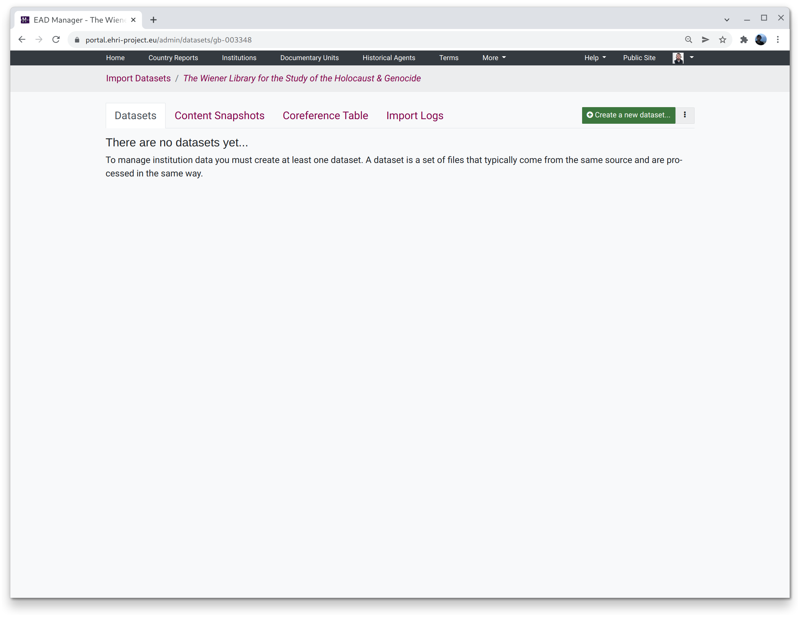

Importing Institution Data
==========================

.. toctree::
   :hidden:
   :maxdepth: 1

   datasets/index
   content-snapshots
   coreference-table
   import-logs
   for-publishers

This documentation describes the Import Manager, EHRI's tool for managing, transforming and ingesting *structured data*
collection descriptions. In a nutshell, it allows administrators to:

* manually upload or harvest data in XML or :doc:`CSV format <datasets/csv-import>`
* validate XML against EHRI's EAD schema
* transform arbitrary XML to EAD using either XSLT or tabular XQuery mappings
* ingest the resulting EAD XML (or CSV) into the EHRI portal
* perform cleanup actions to keep the EHRI portal in sync with third-party datasets

Accessing the Import Manager
----------------------------

The Import Manager can be accessed via the "Ingest" section on the institutions admin page.

Overview of the Import Manager
------------------------------

The Import Manager home page has four tabs:

* :doc:`Datasets <datasets/index>`
* :doc:`Content Snapshots <content-snapshots>`
* :doc:`Coreference Table <coreference-table>`
* :doc:`Import Logs <import-logs>`

For common cases you'll only have to use the :doc:`Datasets <datasets/index>` tab. See :ref:`here <transformation>` for info about
transformation datasets via :ref:`XSLT <xslt>` or :doc:`XQuery <datasets/xquery-mappings>`.

For guidance on how institutions can prepare and publish their metadata so that it can be imported, see
:doc:`for-publishers`.

